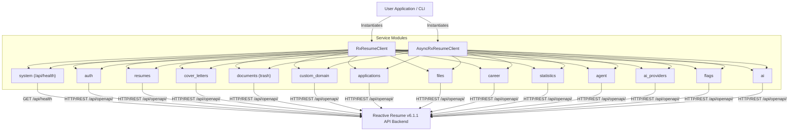

# Reactive Resume Python SDK (`rxresume-python`)

[](https://github.com/AtaCanYmc/reactive-resume-api-client-py/actions/workflows/ci.yml)
[](https://pypi.org/project/rxresume-python/)
[](https://www.python.org/downloads/)
[](LICENSE)

An unofficial, type-safe Python API client and command-line interface (CLI) for **Reactive Resume v4**.

Provides synchronous (`httpx.Client`) and asynchronous (`httpx.AsyncClient`) clients with Pydantic v2 schemas, typed exception handling, and a zero-dependency CLI.

---

## Table of Contents

- [Features](#features)
- [Architecture](#architecture)
- [Capability Matrix](#capability-matrix)
- [Installation](#installation)
- [Quick Start](#quick-start)
  - [Docker Fast-Path (Demo Application)](#docker-fast-path-demo-application)
  - [Asynchronous Client](#asynchronous-client)
  - [Synchronous Client](#synchronous-client)
- [Command-Line Interface (CLI)](#command-line-interface-cli)
- [Error Handling](#error-handling)
- [Development and Testing](#development-and-testing)
- [Contributing](#contributing)
- [Security](#security)
- [License](#license)

---

## Features

- **Dual client interfaces**: Complete synchronous and asynchronous API support.
- **Reactive Resume v6.1.1 alignment**: Endpoints for Resumes, Standalone Cover Letters, Job Applications, Document Trash/Restore, Custom Domains, System Health check (`/api/health`), AI Agent, AI Providers, Global Statistics, and Feature Flags.
- **Type safety**: Fully typed models for all entities using Pydantic v2.
- **Structured error handling**: Maps HTTP 401, 403, 404, and 5xx responses to descriptive Python exceptions.
- **Built-in CLI (`rxresume`)**: Command-line tool for managing profiles, downloading resumes, managing cover letters and trash, inspecting server health, and interacting with AI agents.
- **FastMCP Server**: Built-in Model Context Protocol server exposing resume inspection, tailoring, cover letter creation, and ATS checks to Claude, Cursor, and AI coding assistants.

---

## Architecture



---

## Capability Matrix

| Service Module | Sync | Async | Key Mapped Operations |
| :--- | :---: | :---: | :--- |
| **System** (`client.system` / `client.health()`) | Yes | Yes | Unauthenticated health check (`/api/health`), service version, database, redis, and storage statuses |
| **Resumes** (`client.resumes`) | Yes | Yes | List (paginated), Get, Create, Update, Delete, Import, Export (PDF/DOCX/MD/JSON), Lock/Unlock, Password, Versions, ATS Checks, Job Matches, Slug Check, Statistics |
| **Cover Letters** (`client.cover_letters`) | Yes | Yes | List, Get, Create, Update, Delete, Export (v6 standalone document architecture) |
| **Documents** (`client.documents`) | Yes | Yes | Document counts, Move to Trash, Restore from Trash, Permanent Purge |
| **Custom Domain** (`client.custom_domain`) | Yes | Yes | Get, Set, Verify, and Delete custom domain mapping |
| **Applications** (`client.applications`) | Yes | Yes | List (paginated), Get, Create, Delete, Close with reason, Stage Summary, Kanban Lanes, List Tags, Bulk Import |
| **Files** (`client.files`) | Yes | Yes | Upload user assets (avatars, attachments up to 10MB), Delete file from storage |
| **Career** (`client.career`) | Yes | Yes | User career profile, Career facts list/create/delete for AI assistant |
| **Auth** (`client.auth`) | Yes | Yes | List Providers, Export Account, Delete Account |
| **Statistics** (`client.statistics`) | Yes | Yes | Complete Overview, Users Count, GitHub Stars, Resumes Count |
| **Auth** (`client.auth`) | Yes | Yes | List Providers, Export Account, Delete Account |
| **Statistics** (`client.statistics`) | Yes | Yes | Users Count, GitHub Stars, Resumes Count |
| **Agent** (`client.agent`) | Yes | Yes | List/Create/Archive Threads, Send Message, Stop Run, Stream Resume, Revert Actions |
| **AI Providers** (`client.ai_providers`) | Yes | Yes | List, Create, Update, Delete, Test Provider Connection |
| **AI Functions** (`client.ai`) | Yes | Yes | Parse PDF, Parse DOCX, Chat, Analyze Resume |
| **Feature Flags** (`client.flags`) | Yes | Yes | List Server-side Feature Flags |

---

## Installation

### Homebrew (macOS & Linux)

Install the standalone CLI and FastMCP server directly via the official Homebrew tap:

```bash
brew tap AtaCanYmc/tap
brew install rxresume
```

Alternatively, direct tap without repository registration:

```bash
brew install AtaCanYmc/tap/rxresume
```

### PyPI (Python Library & CLI)

```bash
# Core SDK and CLI
pip install rxresume-python

# With FastMCP Model Context Protocol server support
pip install "rxresume-python[mcp]"

# With development and demo dependencies
pip install "rxresume-python[dev,demo,mcp]"
```

---

## Quick Start

### Docker Fast-Path (Demo Application)

To run the bundled Flask demo application using Docker Compose:

```bash
export RX_RESUME_URL="https://rxresu.me"
export RX_RESUME_API_KEY="your_api_key_here"
docker compose -f demo/docker-compose.yml up --build
```

Access the web interface at `http://localhost:5000`.

### Asynchronous Client

```python
import asyncio
from reactive_resume import AsyncRxResumeClient
from reactive_resume.models import Basics, ResumeImportData


async def main():
    async with AsyncRxResumeClient(
        base_url="https://rxresu.me",
        api_key="your_api_key",
    ) as client:
        # Import or create a new resume
        payload = ResumeImportData(
            title="Software Engineer CV",
            basics=Basics(
                name="Alex Smith",
                headline="Software Engineer",
                email="alex@example.com",
            ),
        )
        resume = await client.resumes.import_resume(payload)
        print(f"Created: {resume.name} (ID: {resume.id})")

        # Retrieve PDF download link
        pdf_url = await client.resumes.get_pdf_url(resume.id)
        print(f"PDF URL: {pdf_url}")


if __name__ == "__main__":
    asyncio.run(main())
```

### Synchronous Client

```python
from reactive_resume import RxResumeClient

with RxResumeClient(base_url="https://rxresu.me", api_key="your_api_key") as client:
    resumes = client.resumes.list()
    for resume in resumes:
        print(f"Resume: {resume.name} (Slug: {resume.slug})")

    stats = client.statistics.get_users_count()
    print(f"Total Platform Users: {stats}")
```

---

## Command-Line Interface (CLI)

The SDK installs a command-line tool named `rxresume`.

### Configuration Profiles

Configure server connection details to avoid passing flags on every execution:

```bash
# Set default instance URL and API Key
rxresume config set-url https://rxresu.me
rxresume config set-key your_api_key_here

# Create or switch to another profile
rxresume config use-profile local
rxresume config set-url http://localhost:3000
rxresume config set-key local_dev_key
```

### CLI Command Reference

| Command | Action | Example |
| :--- | :--- | :--- |
| `rxresume health` | Check server health, dependencies, and version | `rxresume health` |
| `rxresume resumes list` | List resumes (table or json) | `rxresume resumes list --format table` |
| `rxresume resumes get <id>` | View resume details | `rxresume resumes get res-123` |
| `rxresume resumes download <id>` | Download resume file (pdf, docx, md, json) | `rxresume resumes download res-123 -o cv.pdf --format pdf` |
| `rxresume resumes import -f <file>` | Import resume from JSON | `rxresume resumes import -f data.json` |
| `rxresume resumes batch-import <dir>` | Mass import JSON Resume, Reactive Resume, and PDF files | `rxresume resumes batch-import ./resumes --dry-run` |
| `rxresume resumes lock <id>` | Lock resume against changes | `rxresume resumes lock res-123` |
| `rxresume cover-letters list` | List standalone cover letters | `rxresume cover-letters list` |
| `rxresume documents trash <id>` | Move a document to 30-day trash | `rxresume documents trash res-123` |
| `rxresume documents restore <id>` | Restore a document from trash | `rxresume documents restore res-123` |
| `rxresume custom-domain get` | View custom domain configuration | `rxresume custom-domain get` |
| `rxresume ai parse-pdf <file>` | Extract resume JSON from PDF | `rxresume ai parse-pdf cv.pdf --provider prov-1` |
| `rxresume agent chat` | Interactive terminal agent chat | `rxresume agent chat --resume-id res-123` |
| `rxresume stats users` | Get total registered users | `rxresume stats users` |
| `rxresume mcp` | Launch FastMCP Model Context Protocol server | `rxresume mcp --transport stdio` |

---

## Model Context Protocol (MCP) Server

The SDK bundles a FastMCP server that connects LLM clients (such as Claude Desktop, Cursor, and Antigravity) directly to your Reactive Resume instance.

### Installation

Install the MCP extra:

```bash
pip install "rxresume-python[mcp]"
```

### Running the Server

```bash
# Run over stdio (default for AI assistants)
rxresume-mcp

# Or via the CLI
rxresume mcp --transport stdio

# Run as SSE server on a custom port
rxresume-mcp --transport sse --port 8080
```

### Claude Desktop Configuration

Add the following to your `claude_desktop_config.json`:

```json
{
  "mcpServers": {
    "reactive-resume": {
      "command": "rxresume-mcp",
      "env": {
        "RX_RESUME_URL": "https://rxresu.me",
        "RX_RESUME_API_KEY": "your_api_key_here"
      }
    }
  }
}
```

### Provided MCP Capabilities

- **Tools (15)**: `check_health`, `list_resumes`, `get_resume`, `export_resume`, `get_resume_checks`, `match_job_description`, `list_cover_letters`, `create_cover_letter`, `list_job_applications`, `close_job_application`, `get_document_counts`, `trash_document`, `restore_document`, `list_career_facts`, `create_career_fact`.
- **Resources**: `rxresume://health`, `rxresume://resumes/{resume_id}`.
- **Prompts**: `tailor_resume_for_job`, `write_cover_letter_for_job`.

---

## JSON Resume Interoperability

Convert between Reactive Resume models and standard [JSON Resume](https://jsonresume.org/) format, or export directly from the client:

```python
from reactive_resume import RxResumeClient
from reactive_resume.utils.json_resume import from_json_resume, to_json_resume, validate_json_resume

# Direct export to JSON Resume format
with RxResumeClient(base_url="https://rxresu.me", api_key="your_api_key") as client:
    json_resume_data = client.resumes.export_json_resume("resume-id")

# Validate standard schema compliance
is_valid, errors = validate_json_resume(json_resume_data)

# Transform back into a Reactive Resume import payload
import_payload = from_json_resume(json_resume_data, title="Imported Profile")
```

---

## Real-Time Agent Streaming

Consume Server-Sent Events (SSE) from the AI career assistant in real time:

```python
from reactive_resume import RxResumeClient

with RxResumeClient(base_url="https://rxresu.me", api_key="your_api_key") as client:
    for event in client.agent.resume_message_stream(thread_id="thread-xyz"):
        print(f"[{event.event}] {event.data}")
```

Async streaming is also natively supported:

```python
from reactive_resume import AsyncRxResumeClient

async with AsyncRxResumeClient(base_url="https://rxresu.me", api_key="your_api_key") as client:
    async for event in client.agent.resume_message_stream(thread_id="thread-xyz"):
        print(f"[{event.event}] {event.data}")
```

---

## Offline Testing (`MockRxResumeClient`)

Test your application, bots, and agents without requiring a live Reactive Resume server or network connection:

```python
from reactive_resume.testing import MockRxResumeClient, AsyncMockRxResumeClient
from reactive_resume.models import ResumeImportData

with MockRxResumeClient() as client:
    created = client.resumes.create(ResumeImportData(title="Dev Resume", slug="dev-resume"))
    pdf_bytes = client.resumes.export(created.id, format="pdf")
    assert b"%PDF" in pdf_bytes
```

---

## Error Handling

All client methods translate HTTP error statuses into explicit exception classes:

```python
from reactive_resume import AuthenticationError, NotFoundError, RxResumeClient

try:
    with RxResumeClient(base_url="https://rxresu.me", api_key="invalid_key") as client:
        client.resumes.list()
except AuthenticationError as e:
    print(f"Authentication failed ({e.status_code}): {e}")
except NotFoundError as e:
    print(f"Resource not found: {e}")
```

---

## Development and Testing

The repository provides a `Makefile` for local testing and code verification:

```bash
# Clone the repository
git clone https://github.com/AtaCanYmc/reactive-resume-api-client-py.git
cd reactive-resume-api-client-py

# Install dependencies using uv
uv sync --all-extras

# Run verification checks (lint, typecheck, tests)
make check
```

---

## Contributing

See [CONTRIBUTING.md](CONTRIBUTING.md) for branch naming conventions, Conventional Commit standards, and pull request verification instructions.

---

## Security

See [SECURITY.md](SECURITY.md) for supported versions and instructions on reporting security vulnerabilities privately.

---

## License

This project is licensed under the MIT License. See [LICENSE](LICENSE) for details.
