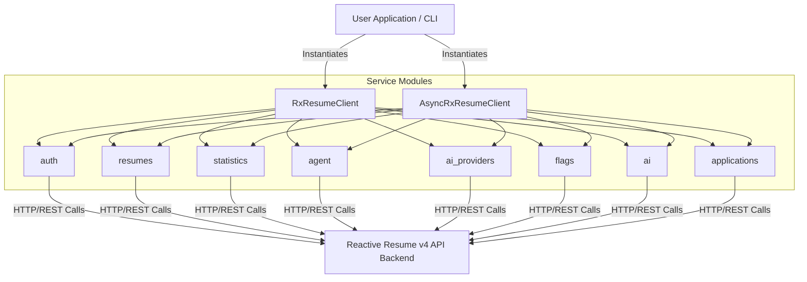

# Reactive Resume Python SDK (`rxresume-python`)

[](https://github.com/AtaCanYmc/reactive-resume-api-client-py/actions/workflows/ci.yml)
[](https://pypi.org/project/rxresume-python/)
[](https://www.python.org/downloads/)
[](LICENSE)

An unofficial, type-safe Python API client and command-line interface (CLI) for **Reactive Resume v4**.

Provides synchronous (`httpx.Client`) and asynchronous (`httpx.AsyncClient`) clients with Pydantic v2 schemas, typed exception handling, and a zero-dependency CLI.

---

## Table of Contents

- [Features](#features)
- [Architecture](#architecture)
- [Capability Matrix](#capability-matrix)
- [Installation](#installation)
- [Quick Start](#quick-start)
  - [Docker Fast-Path (Demo Application)](#docker-fast-path-demo-application)
  - [Asynchronous Client](#asynchronous-client)
  - [Synchronous Client](#synchronous-client)
- [Command-Line Interface (CLI)](#command-line-interface-cli)
- [Error Handling](#error-handling)
- [Development and Testing](#development-and-testing)
- [Contributing](#contributing)
- [Security](#security)
- [License](#license)

---

## Features

- **Dual client interfaces**: Complete synchronous and asynchronous API support.
- **Full API coverage**: Endpoints for Resumes, Job Applications, AI Agent, AI Providers, Global Statistics, and Feature Flags.
- **Type safety**: Fully typed models for all entities using Pydantic v2.
- **Structured error handling**: Maps HTTP 401, 403, 404, and 5xx responses to descriptive Python exceptions.
- **Built-in CLI (`rxresume`)**: Command-line tool for managing profiles, downloading PDFs, analyzing resumes, and chatting with AI agents.

---

## Architecture



---

## Capability Matrix

| Service Module | Sync | Async | Key Mapped Operations |
| :--- | :---: | :---: | :--- |
| **Resumes** (`client.resumes`) | Yes | Yes | List, Get, Create, Update, Delete, Import, Download PDF, Lock/Unlock, Password, Versions, Statistics |
| **Applications** (`client.applications`) | Yes | Yes | List, Get, Create, Delete, List Tags, Pipeline Statistics, Bulk Import |
| **Auth** (`client.auth`) | Yes | Yes | List Providers, Export Account, Delete Account |
| **Statistics** (`client.statistics`) | Yes | Yes | Users Count, GitHub Stars, Resumes Count |
| **Agent** (`client.agent`) | Yes | Yes | List/Create/Archive Threads, Send Message, Stop Run, Stream Resume, Revert Actions |
| **AI Providers** (`client.ai_providers`) | Yes | Yes | List, Create, Update, Delete, Test Provider Connection |
| **AI Functions** (`client.ai`) | Yes | Yes | Parse PDF, Parse DOCX, Chat, Analyze Resume |
| **Feature Flags** (`client.flags`) | Yes | Yes | List Server-side Feature Flags |

---

## Installation

```bash
pip install rxresume-python
```

For development and demo dependencies:

```bash
pip install "rxresume-python[dev,demo]"
```

---

## Quick Start

### Docker Fast-Path (Demo Application)

To run the bundled Flask demo application using Docker Compose:

```bash
export RX_RESUME_URL="https://rxresu.me"
export RX_RESUME_API_KEY="your_api_key_here"
docker compose -f demo/docker-compose.yml up --build
```

Access the web interface at `http://localhost:5000`.

### Asynchronous Client

```python
import asyncio
from reactive_resume import AsyncRxResumeClient
from reactive_resume.models import Basics, ResumeImportData


async def main():
    async with AsyncRxResumeClient(
        base_url="https://rxresu.me",
        api_key="your_api_key",
    ) as client:
        # Import or create a new resume
        payload = ResumeImportData(
            title="Software Engineer CV",
            basics=Basics(
                name="Alex Smith",
                headline="Software Engineer",
                email="alex@example.com",
            ),
        )
        resume = await client.resumes.import_resume(payload)
        print(f"Created: {resume.name} (ID: {resume.id})")

        # Retrieve PDF download link
        pdf_url = await client.resumes.get_pdf_url(resume.id)
        print(f"PDF URL: {pdf_url}")


if __name__ == "__main__":
    asyncio.run(main())
```

### Synchronous Client

```python
from reactive_resume import RxResumeClient

with RxResumeClient(base_url="https://rxresu.me", api_key="your_api_key") as client:
    resumes = client.resumes.list()
    for resume in resumes:
        print(f"Resume: {resume.name} (Slug: {resume.slug})")

    stats = client.statistics.get_users_count()
    print(f"Total Platform Users: {stats}")
```

---

## Command-Line Interface (CLI)

The SDK installs a command-line tool named `rxresume`.

### Configuration Profiles

Configure server connection details to avoid passing flags on every execution:

```bash
# Set default instance URL and API Key
rxresume config set-url https://rxresu.me
rxresume config set-key your_api_key_here

# Create or switch to another profile
rxresume config use-profile local
rxresume config set-url http://localhost:3000
rxresume config set-key local_dev_key
```

### CLI Command Reference

| Command | Action | Example |
| :--- | :--- | :--- |
| `rxresume resumes list` | List resumes (table or json) | `rxresume resumes list --format table` |
| `rxresume resumes get <id>` | View resume details | `rxresume resumes get res-123` |
| `rxresume resumes download <id>` | Download resume as PDF file | `rxresume resumes download res-123 -o cv.pdf` |
| `rxresume resumes import -f <file>` | Import resume from JSON | `rxresume resumes import -f data.json` |
| `rxresume resumes lock <id>` | Lock resume against changes | `rxresume resumes lock res-123` |
| `rxresume ai parse-pdf <file>` | Extract resume JSON from PDF | `rxresume ai parse-pdf cv.pdf --provider prov-1` |
| `rxresume agent chat` | Interactive terminal agent chat | `rxresume agent chat --resume-id res-123` |
| `rxresume stats users` | Get total registered users | `rxresume stats users` |

---

## Error Handling

All client methods translate HTTP error statuses into explicit exception classes:

```python
from reactive_resume import AuthenticationError, NotFoundError, RxResumeClient

try:
    with RxResumeClient(base_url="https://rxresu.me", api_key="invalid_key") as client:
        client.resumes.list()
except AuthenticationError as e:
    print(f"Authentication failed ({e.status_code}): {e}")
except NotFoundError as e:
    print(f"Resource not found: {e}")
```

---

## Development and Testing

The repository provides a `Makefile` for local testing and code verification:

```bash
# Clone the repository
git clone https://github.com/AtaCanYmc/reactive-resume-api-client-py.git
cd reactive-resume-api-client-py

# Install dependencies using uv
uv sync --all-extras

# Run verification checks (lint, typecheck, tests)
make check
```

---

## Contributing

See [CONTRIBUTING.md](CONTRIBUTING.md) for branch naming conventions, Conventional Commit standards, and pull request verification instructions.

---

## Security

See [SECURITY.md](SECURITY.md) for supported versions and instructions on reporting security vulnerabilities privately.

---

## License

This project is licensed under the MIT License. See [LICENSE](LICENSE) for details.
